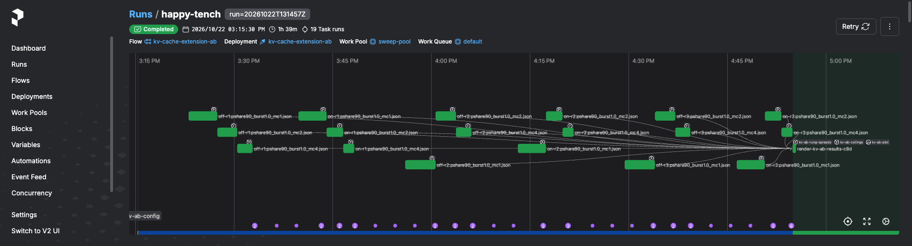
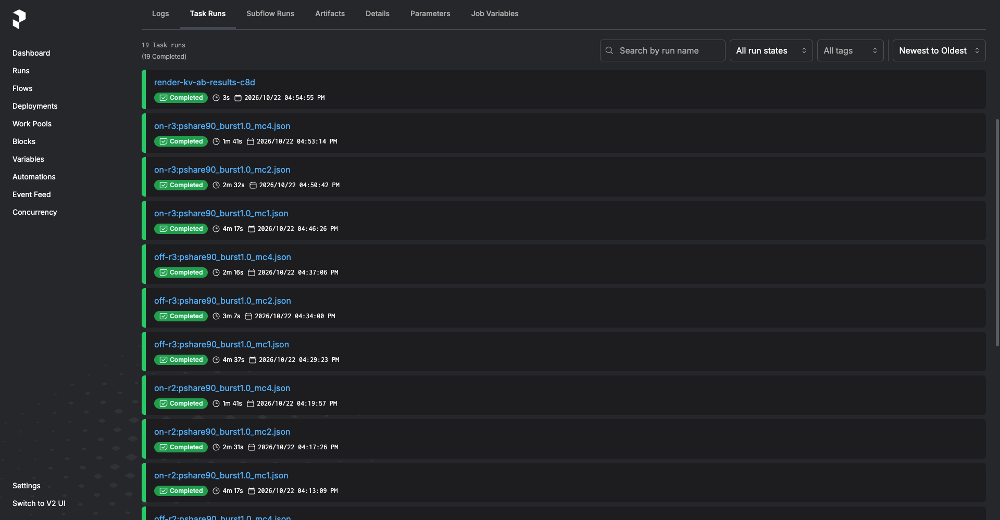
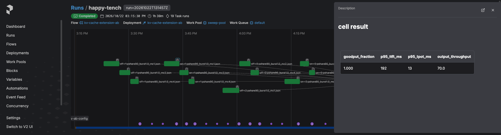
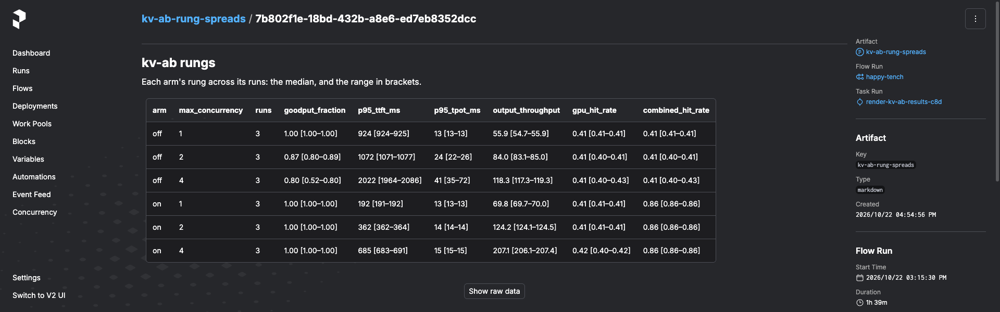
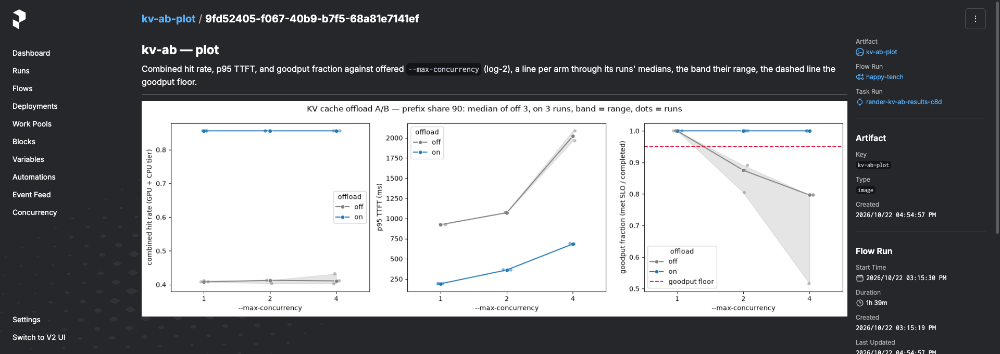

<div align="center">


<br><br>

[](https://github.com/pvardanis/slipstream/actions/workflows/ci.yml)
[](https://www.python.org/downloads/)
[](https://github.com/astral-sh/ruff)
[](https://github.com/astral-sh/ty)
[](https://github.com/astral-sh/uv)
[](https://developer.hashicorp.com/terraform)
[](https://github.com/vllm-project/vllm)
[](#architecture)

</div>

A self-hosted LLM inference platform on AWS EKS. Today it serves an AWQ-quantized open
model with vLLM on a Karpenter-provisioned `g5` GPU node and benchmarks it from outside
the cluster. An unattended two-tier knob sweep (engine knobs × client concurrency)
finds each configuration's sustained concurrency ceiling at an SLO, and a KV cache A/B
measures what offloading KV cache to a CPU tier (LMCache) adds on top of the GPU prefix
cache. `just stack-up` / `just stack-down` conjure and destroy the whole rig. Like the
low-drag wake it is named after, every layer exists to move more tokens per dollar.

The build spec is [`docs/spec.md`](docs/spec.md); decisions are recorded in
[`docs/adr/`](docs/adr/) and terms in [`CONTEXT.md`](CONTEXT.md).

## Architecture

```mermaid
---
config:
  elk:
    nodePlacementAlignment: LEFTUP
---
flowchart TB
    op([Operator])

    subgraph gha[GitHub Actions]
        ci[ci.yml<br/>lint, tests, no-push builds]
        img[bench-image /<br/>orchestration-image]
        disp[sweep-dispatch /<br/>kv-ab-dispatch]
    end

    subgraph aws[AWS]
        awslogo@{ img: "https://raw.githubusercontent.com/pvardanis/slipstream/main/docs/icons/aws/aws-cloud.svg", label: "", pos: "b", w: 32, h: 32, constraint: "on" }
        ecr@{ img: "https://raw.githubusercontent.com/pvardanis/slipstream/main/docs/icons/aws/ecr.svg", label: "ECR", pos: "b", w: 48, h: 48, constraint: "on" }
        subgraph eks[EKS]
            ekslogo@{ img: "https://raw.githubusercontent.com/pvardanis/slipstream/main/docs/icons/aws/eks.svg", label: "", pos: "b", w: 32, h: 32, constraint: "on" }
            vllm[vLLM on g5<br/>Karpenter,<br/>optional LMCache CPU tier]
            ps@{ img: "https://raw.githubusercontent.com/pvardanis/slipstream/main/docs/icons/prefect/prefect.svg", label: "Prefect server", pos: "b", w: 48, h: 48, constraint: "on" }
            pw[Prefect worker]
        end
        alb@{ img: "https://raw.githubusercontent.com/pvardanis/slipstream/main/docs/icons/aws/alb.svg", label: "mTLS ALB", pos: "b", w: 48, h: 48, constraint: "on" }
        host@{ img: "https://raw.githubusercontent.com/pvardanis/slipstream/main/docs/icons/aws/ec2-instance.svg", label: "Bench host", pos: "b", w: 48, h: 48, constraint: "on" }
        s3@{ img: "https://raw.githubusercontent.com/pvardanis/slipstream/main/docs/icons/aws/s3-bucket.svg", label: "S3 results", pos: "b", w: 48, h: 48, constraint: "on" }
    end

    op -- push / PR --> ci
    op -- merge to main --> img
    op -- workflow_dispatch --> disp
    op -- just stack-up / down --> eks
    img -- OIDC push --> ecr
    disp -- OIDC + port-forward:<br/>register + run --> ps
    ps --> pw
    pw -- redeploy per point<br/>or arm run --> vllm
    pw -- SSM: one docker run per cell --> host
    ecr -. image .-> host & pw
    host -- load --> alb --> vllm
    host -- result JSON --> s3
    pw -- "charts, A/B records,<br/>Prefect results + cache keys" --> s3
```

The CI/CD pipeline and the benchmark data path are detailed in
[`docs/architecture.md`](docs/architecture.md).

## Prerequisites

| Tool | Version | Used for |
| --- | --- | --- |
| `terraform` | >= 1.11 | all infrastructure |
| `just`, `kubectl`, `aws` CLI | — | recipes, cluster access, SSM |
| `uv` | >= 0.5 | Python workspace, `prefect` CLI |
| `docker` | — | local bench-image builds |
| `prek`, `tflint` | — | git hooks |
| `gh` | — | setting repo variables (`just gh-vars`) |

On macOS (Homebrew core ships a frozen terraform 1.5.7, so use HashiCorp's tap):

```sh
brew install hashicorp/tap/terraform just tflint awscli kubectl uv prek gh   # + Docker Desktop
```

Optional: `k9s`, `stern`, `kubens` for inspecting the `slipstream` namespace.

## Setup

### Local environment

```sh
uv sync          # workspace members + dev tools (pytest, ruff, ty)
prek install     # git hooks: ruff, terraform fmt/tflint, shellcheck, shfmt, actionlint
just cli-test    # local suite, no cluster
```

### AWS access

Work from a dedicated IAM user, not the account root: root cannot hold an EKS access
entry. Create the user (VPC/EKS permissions, console access + MFA), give it an access
key, and sign in to the console as that user to inspect EKS there. Then:

```sh
aws configure --profile slipstream-admin   # access key + region (eu-west-1)
export AWS_PROFILE=slipstream-admin        # the only variable you set by hand
```

`just cluster-up` grants cluster-admin to the caller, so `kubectl` works immediately.
The recipes read the region from Terraform outputs; a profile pointing at another region
will not find the resources.

### New environment or fork

Once per AWS account / repository. The image workflows need the repo variables, and
`just cluster-up` deploys the Prefect worker from the published orchestration image,
hence the order:

1. In a fork or renamed repo, set `github_oidc_sub_prefix` in `terraform/bootstrap` to
   the repo's OIDC subject prefix, otherwise every workflow fails with
   `Not authorized to perform sts:AssumeRoleWithWebIdentity`:
   ```sh
   gh api repos/OWNER/REPO/actions/oidc/customization/sub --jq .sub_claim_prefix
   ```
2. `just grafana-cloud-setup` — walks through creating the Grafana Cloud stack, then
   applies the bootstrap stack: remote-state bucket, ECR repositories, GitHub OIDC
   roles, the spend-leak guard, and the Grafana Cloud token secrets and Assume Role.
   It writes `grafana_external_id`, and `operator_email` when unset, into the gitignored
   `terraform/bootstrap/terraform.tfvars`, stores both Grafana Cloud tokens in
   Secrets Manager, and writes the stack URL as `grafana_url` into the gitignored
   `terraform/grafana/terraform.tfvars` ([runbook](docs/operations.md#grafana-cloud-setup)).
   Click the confirmation link AWS emails ([runbook](docs/operations.md#spend-leak-alert)).
   Later `just bootstrap` runs, in any worktree, take `grafana_external_id` and
   `operator_email` from `terraform/bootstrap/terraform.tfvars` or their `TF_VAR_`, and
   otherwise read them back from AWS, so a fresh worktree bootstraps without the wizard.
3. `just grafana-up` — applies the grafana stack: the CloudWatch data source, which
   reads CloudWatch through the bootstrap stack's IAM role. It asks before applying and
   has no down recipe. Then click Save & test on the data source
   ([runbook](docs/operations.md#grafana-data-sources)).
4. `just gh-vars` — sets the eight repo variables the workflows read from the
   bootstrap outputs.
5. Dispatch `bench-image` and `orchestration-image` on `main` to publish the images.
   ECR keeps them across `just stack-down`, so this is once per environment.

## Quickstart

```sh
just stack-up             # cluster + Prefect + GPU pool + vLLM + bench endpoint
# trigger a knob sweep: Actions → sweep-dispatch → Run workflow (on main)
# or a KV cache A/B:    Actions → kv-ab-dispatch → Run workflow (on main)
just bench-results-sync   # pull results into bench/results/ — before stack-down
just stack-down           # tear down, then zero-leak sweep (spend → 0)
```

The bench endpoint is public and every node bills while up: **run `just stack-down`
when done.** Only the state bucket and ECR repositories survive it; the results bucket
is deleted with its contents, so sync first. `stack-down` exits non-zero if a tagged
instance or volume survived, and skips `cluster-down` (leaving the cluster billing) if
the endpoint teardown failed: fix that and rerun. Running a sweep locally, single
points, pinned images and the cloud-verify check are in
[`docs/operations.md`](docs/operations.md); `uv run slipstream-bench --help` lists the
bench CLI.

## What a benchmark run looks like

The platform runs two kinds of benchmark:

- **Knob sweep** finds the engine config to deploy. It redeploys vLLM once per point of an
  engine-knob grid (`max_num_seqs` × KV cache dtype × prefix caching) and steps each point up a
  client-concurrency ladder until it breaks the goodput SLO. The highest rung that holds is
  that point's concurrency ceiling, and the point with the most output throughput at its
  ceiling is the cheapest per token.
- **KV cache offload A/B** measures what offloading KV cache to LMCache's CPU tier adds on
  top of the GPU prefix cache. It runs one engine point with offload off and on,
  interleaved over repeated runs, up the same kind of ladder, and compares the arms' ranges
  at each rung.

Each is a Prefect flow run you follow from the UI (`just prefect-ui`). These are from KV
cache offload A/B run `20261022T131457Z`. Each arm
redeploys vLLM, either with KV cache offload to LMCache's CPU tier enabled (on) or
without it (off). It then runs three repetitions of the `max_concurrency` ladder, and one
task renders the tables and the chart as artifacts:



Every cell is a task run: one arm's repetition at one rung. The final task renders the
results:



Clicking the artifact marker on a cell in the flow graph opens that cell's result as
markdown in a side panel:



The `kv-ab-rung-spreads` artifact gives each arm's median and range per rung, and
`kv-ab-plot` charts them against the goodput floor:





This run, on the g5.xlarge, capped the GPU KV pool at 16,384 tokens, below LMCache's CPU
tier: the g5.xlarge's RAM cannot hold a tier larger than the uncapped pool, and the
account had no G-instance quota for the g5.2xlarge that could
([ADR-0023](docs/adr/0023-kv-cache-extension-cpu-tier-and-ab.md)). On this workload (90%
shared prefix, working set 1.5× the capped pool), enabling LMCache offload held the SLO up
to `max_concurrency` 4, while off held it only at 1. That is 3.7× the output throughput at
the SLO. It measures the mechanism on the capped pool, not a gain on the uncapped rig. The
full verdict is in
[`reports/kv-cache-ab-20261022T131457Z/`](reports/kv-cache-ab-20261022T131457Z/RECOMMENDATION.md).

## Skills

Two Claude Code skills analyse a finished run. Each reads the run's artifacts from the
Prefect API and writes a report, with the run's charts, under `reports/`. Neither one
re-runs anything.

| Skill | Run | Writes |
| --- | --- | --- |
| [`analyze-knob-sweep`](.claude/skills/analyze-knob-sweep/SKILL.md) | knob sweep | `reports/sweep-grid-<stamp>/`: the engine config to deploy for the run's SLO, ranked by throughput at the concurrency ceiling |
| [`analyze-kv-ab`](.claude/skills/analyze-kv-ab/SKILL.md) | KV cache offload A/B | `reports/kv-cache-ab-<run_id>/`: whether LMCache offload paid off, rung by rung, with the hit-rate check, the cost ratio, the CPU tier's host-memory cost, and whether to turn offload on by default |

Invoke one with the run's id, e.g. `/analyze-kv-ab 20261022T131457Z`, with
`just prefect-ui` running.

### Grafana MCP server

The project's [`.mcp.json`](.mcp.json) gives Claude Code the
[Grafana MCP server](https://github.com/grafana/mcp-grafana), so a session can run
PromQL and TraceQL against the Grafana Cloud stack and read its dashboards. Claude Code
starts it with `just grafana-mcp` and asks you to approve it on first use. The server
runs read-only, because the grafana Terraform stack owns the stack's dashboards and data
sources.

It needs `uv`, AWS credentials for the account (`AWS_PROFILE`), and
`just grafana-cloud-setup` done. It reads the API token from the bootstrap stack's
Secrets Manager secret each time it starts, so the token never lands in a file. It reads
the stack URL from `GRAFANA_URL`, then `TF_VAR_grafana_url`, then `grafana_url` in
`terraform/grafana/terraform.tfvars`, and otherwise from the grafana stack's
`grafana_url` output, so a fresh worktree needs no setup once `just grafana-up` has
run. Claude Code holds a session's first turn until the server connects, which takes
about 5 seconds, longer the first time `uvx` fetches the server or a fresh worktree
initialises the grafana stack. `/mcp` shows whether the server connected. If it did
not, run `just grafana-mcp` in a terminal to see the error; if that starts but Claude
Code reports a timeout, raise its 30-second startup limit, e.g. `MCP_TIMEOUT=60000 claude`.

## Recipes

`just` (or `just --list`) lists every recipe, grouped by concern
([ADR-0013](docs/adr/0013-justfile-imported-lifecycle-modules.md)):

| Group | Covers |
| --- | --- |
| `cluster` | Remote-state bootstrap, EKS up/plan/down, GPU node pool, repo variables |
| `prefect` | Work pool, deployment registration, UI port-forward (`prefect-ui`), storage drain |
| `serve` | vLLM api-key Secret, GPU replica deploy/scale, completion smokes |
| `bench` | Bench-client image, one point's ladder, prefix-cache, results sync, mTLS endpoint |
| `obs` | Persistent grafana stack (`grafana-up`), OTel Collector spine stub |
| `test` | Python suite and shell unit tests (no cluster) |
| `dev` | Grafana MCP server for Claude Code (`grafana-mcp`) |
| `orchestrate` | Whole-stack up/down, cloud verification |

## Roadmap

Planned in [`docs/spec.md`](docs/spec.md) §4, not yet built:

- **L2a** — autoscaling on inference signals and cold-start elimination
- **L2b** — spot-eviction survival mid-stream
- **L3** — inference-aware routing
- **L4** — prefill/decode disaggregation

## Deliberate trade-offs

The rig is one GPU on a duty-cycle budget, and most of what it does not do follows
from that:

- **One long-lived worker, not a pod per run.** The sweep runs on a single Prefect
  process worker (one replica, work-pool concurrency 1) that lives as long as the
  cluster. A Kubernetes Job per flow run buys isolation, per-run resources, and parallel
  autoscale, none of which help a serial sweep on one static GPU node. A GPU fleet that
  makes engine points truly parallel is the trigger to switch to a kubernetes pool
  ([ADR-0015](docs/adr/0015-unattended-sweep-cloud-server-and-parent-flow.md)).
- **On-demand GPU, not spot.** [`docs/spec.md`](docs/spec.md) plans for spot, but the
  node pool is on-demand only and capped at one GPU: allowing spot cost ~15 min of
  launch thrash in a spot-starved region, where on-demand launches in ~90s
  ([`k8s/gpu-node-pool.yaml`](k8s/gpu-node-pool.yaml)).
- **No always-on control plane.** Prefect Cloud's Starter tier (~$100/mo, the cheapest
  that allows an own-compute worker) or a standing self-hosted stack would add an idle
  cost floor. The Prefect server is self-hosted on SQLite inside
  the cluster and is torn down with it; S3 holds the results and resume state.
- **A duty cycle, not 24/7.** The GPU budget is ~$100–250/mo, while the cheapest 24 GB
  card run continuously is ~$365/mo, so `just stack-down` returns spend to zero between
  sweeps.
- **One sample per cell.** Each knob-sweep cell is measured once; re-sampling is a
  deliberate new `run_id`, never an average taken by default
  ([ADR-0012](docs/adr/0012-sweep-resumability-and-orchestrator-choice.md)). The KV cache
  A/B is the exception: it compares two arms, so each arm is run `runs_per_arm` times,
  interleaved, and reported as median and range.
- **No apply/destroy infra tests per push.** CI runs policy checks and offline
  `terraform test` against mocked providers; the real-spend check, `just cloud-verify`,
  runs by hand ([ADR-0002](docs/adr/0002-infrastructure-testing-strategy.md)).
- **No high availability.** One CPU node, one Karpenter controller, and one Prefect
  server: HA needs a second node, and SQLite on a single-attach EBS volume allows one
  writer. A dead pod fails the in-flight run: Kubernetes restarts the pod, not the run,
  and running it again with the same `run_id` resumes from the cells already measured.
- **No standing endpoint, no laptop runs.** The mutual-TLS load balancer and bench host
  exist only for a run, and recorded numbers never come from a laptop, whose Wi-Fi
  jitter would inflate the p95/p99 tail
  ([ADR-0004](docs/adr/0004-bench-vantage-external-path.md)).

## Non-goals

No fine-tuning or LLM training, no RAG / vector DBs / embeddings, no agent
frameworks, no Ray Train (Ray Serve is in scope), no multi-cloud or portability abstractions, not a real product — this is a
platform demonstrator.
