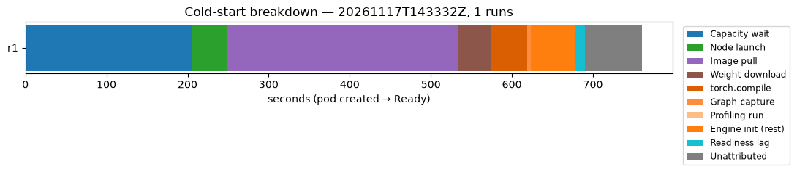

# Cold-start breakdown baseline — 20261117T143332Z

## Run

- **run_id:** `20261117T143332Z` (Prefect flow run `agile-dragon`,
  `8b7c9012-4edc-4c9d-b3e4-528a89da6d0f`, Cancelled after run 1)
- **What it measures:** one cold start from a true zero: no GPU NodeClaim left, the
  `vllm-gpu` Deployment scaled 0 → 1, timed from the pod being created until its Ready
  condition, and split into the six phases plus the unattributed remainder ADR-0030
  defines ([ADR-0030](../../docs/adr/0030-cold-start-breakdown-from-cluster-events-and-engine-logs.md)).
- **Runs:** 1 of the 3 requested. Run 2 began at 14:53 UTC from a verified zero, but EC2
  had no on-demand g5.xlarge capacity in any eu-west-1 zone: every `CreateFleet` until
  15:05 returned `InsufficientInstanceCapacity` for eu-west-1a, 1b and 1c. The flow run
  was cancelled at 15:09 to free the cluster. Its cancellation hooks scaled the replica
  to zero and released the rollout freeze, and no GPU NodeClaim was left.
- **Rig:** on-demand g5.xlarge (1× A10G), Karpenter GPU node pool (ADR-0006)
- **Model:** `Qwen/Qwen3-8B-AWQ` at revision `4da05a8edb55c6046cce958586c33b61da07bb79`,
  `awq_marlin`, fp8 KV cache
- **Images:**
  - vLLM: `vllm/vllm-openai:v0.29.0`
  - orchestration: `<account>.dkr.ecr.eu-west-1.amazonaws.com/slipstream/orchestration:20149dd4ea40`
- **Record:** the flow writes its records to the results bucket and publishes its
  artifact and chart only after every run is measured, so the cancelled run left none of
  them. Run 1's record is the one the worker logged as soon as it was measured
  (`cold-start run=20261117T143332Z r1 measured {...}`). It is committed here as
  [`r1.json`](r1.json), in the shape the bucket stores. The table below is derived from
  it, and the chart is rendered from it by the report package's `plot_cold_start_png`.

## Breakdown

One run, so each phase's range is its single value; there is no spread yet.

| phase | seconds | share of total |
| --- | --- | --- |
| Capacity wait | 205.0 | 27.0% |
| Node launch | 44.0 | 5.8% |
| Image pull | 284.0 | 37.4% |
| Weight download | 41.2 | 5.4% |
| Engine init | 104.2 | 13.7% |
| ↳ torch.compile | 44.8 | |
| ↳ Graph capture | 4.0 | |
| ↳ Profiling run | 0.1 | |
| Readiness lag | 12.0 | 1.6% |
| Unattributed | 69.6 | 9.2% |
| **Total** | **760.0** | |

The ↳ rows are detail inside engine init, not added to it. The phases and the
unattributed remainder add up to the 760.0 s total exactly.

## Reading

- **Image pull is the largest phase:** 284 s (4.7 min), 37% of the cold start, pulling
  the vLLM image onto a fresh node. It is close to the 4.5 min pull on the Fleet health
  dashboard's one recorded bring-up.
- **Capacity wait here is a capacity gap, not scheduling.** Karpenter's first NodeClaim
  (14:34:00) failed with `InsufficientInstanceCapacity`. Karpenter marks a failed
  offering unavailable for about 3 minutes, so the next NodeClaim was created at
  14:37:20, and Karpenter's log shows it launched 3.5 s later. Without the gap, capacity
  wait would have been about 4 s and the cold start about 560 s. Run 2's 12+ minutes of failed launches
  are the same effect at a larger scale (#243 recorded 10–20 min on bad days).
- **Node launch** (NodeClaim `Launched` → `Initialized`, 44 s) covers EC2 boot, node
  registration and the GPU device plugin advertising the GPU.
- **Engine init is 104 s.** torch.compile is 44.8 s of it, which a persisted compile
  cache could remove. Graph capture is 4 s, which no cache removes. The other 55 s
  covers loading weights onto the GPU, weight post-processing, KV cache sizing and
  warmup.
- **Weight download** from Hugging Face takes 41 s.
- **Readiness lag** is 12 s, within the startupProbe's 15 s period on the GPU pod
  (`k8s/vllm-gpu.yaml`): the pod goes Ready on the first probe after the server starts.
- **Unattributed is 69.6 s (9%).** It covers the gaps no marker bounds (ADR-0030):
  scheduling and sandbox creation between node launch and image pull, container start
  through the engine's imports, process start and model init, and the API server's start
  between engine init and `Starting vLLM server on`.

With the capacity gap removed, image pull and engine init together are about 70% of
the cold start, so they are where elimination work starts.

## Chart

One stacked bar for run 1, phases left to right in the order the cold start runs through
them, with engine init split by its detail in shades of orange.

## What this baseline does not give

- **Spread.** With one run there is no median or range across runs, so a later run
  cannot yet be told apart from run-to-run noise. Re-running the `cold-start-breakdown`
  flow unchanged (default 3 runs) once g5.xlarge capacity is back gives the spread.
- **A capacity-free cold start.** Run 1's capacity wait includes one failed launch and
  Karpenter's retry delay; it is the platform's real cold start that day, not its
  best case.
