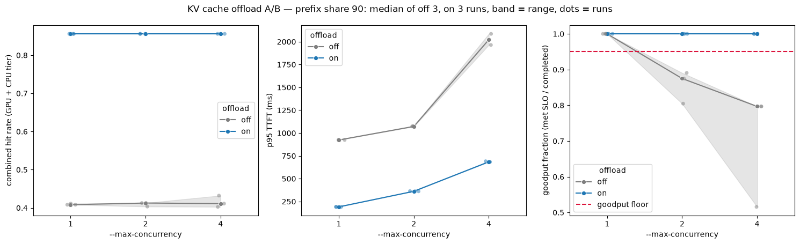

# KV cache A/B — 20261022T131457Z

## Run

- **run_id:** `20261022T131457Z` (Prefect flow run `happy-tench`, `b61fa378-6ab4-4b65-bff6-aa5b22dda38f`, Completed)
- **Arms:** **on** is vLLM with KV cache offload to LMCache's CPU tier enabled (`--kv-transfer-config '{"kv_connector":"LMCacheConnectorV1","kv_role":"kv_both"}'`, pod memory 12Gi for the tier). **off** is vLLM with no KV connector (8Gi). Both keep vLLM's GPU prefix cache. "Offload" below always means KV cache offload to LMCache.
- **SLO:** `ttft:1000`, `tpot:50` (ms); goodput floor `0.95`
- **runs_per_arm:** 3, interleaved off-r1, on-r1, off-r2, on-r2, off-r3, on-r3. Each run redeploys the pod, runs the warmup, then the ladder.
- **Rungs (`max_concurrency`):** 1, 2, 4 (warmup at 1, unrecorded)
- **Workload:** agent workload, `prefix_share` 90%, `num_prefixes` 8, `total_len` 3584, `output_len` 128, `num_prompts` 128, `align_blocks` 256, `request_rate` inf. Each prompt carries a 3072-token shared prefix; the 8 prefixes make a 24,576-token working set.
- **Engine point:** `max_num_seqs` 64, `kv_cache_dtype` fp8
- **CPU tier (on arm):** 4 GiB of pinned host memory (`LMCACHE_MAX_LOCAL_CPU_SIZE` 4.0) in 256-token chunks, about 58,254 fp8 tokens. This workload's prompts fill 28,672 tokens of it.
- **GPU KV pool cap:** `kv_cache_memory_bytes` 1207959552 (16,384 tokens); the working set is 1.5× the pool. The pool is capped because the g5.xlarge's host RAM (14.4 GiB allocatable) cannot hold a CPU tier larger than the uncapped GPU pool (185,696 tokens). The LMCache tier here is about 58k tokens. With a tier smaller than the pool, offload adds no reuse, because reachable reuse is max(GPU, CPU), not their sum. A larger tier needs a g5.2xlarge (32 GiB), and the G-instance vCPU quota increase it needs has not been approved yet. Capping the pool below the tier measures the same mechanism now, at a smaller scale (ADR-0023).
- **Images:**
  - vLLM: `vllm/vllm-openai:v0.29.0`
  - bench: `<account>.dkr.ecr.eu-west-1.amazonaws.com/slipstream/bench-client:qwen3-8b-awq-main`
  - orchestration: `<account>.dkr.ecr.eu-west-1.amazonaws.com/slipstream/orchestration:f1f50a63289f`

## Verdict

**Offload wins:** enabling KV cache offload to LMCache's CPU tier beats the GPU prefix cache alone at all three rungs (1, 2, 4): p95 TTFT and output throughput separate in on's favour at every rung, and goodput fraction separates in on's favour at rungs 2 and 4. This holds for the agent workload above: 90% prefix share, with 8 prefixes whose working set exceeds the capped GPU pool.

## Evidence

Values are `median [min–max]` across 3 runs per arm. "Separates" lists the judged metrics (`goodput_fraction`, `p95_ttft_ms`, `output_throughput`) whose arm ranges do not overlap. Every separation favours on. "Inconclusive" lists the metrics whose off and on ranges overlap, so the run cannot tell the arms apart on them at that rung.

### max_concurrency = 1

| metric | off | on | |
| --- | --- | --- | --- |
| goodput_fraction | 1.00 [1.00–1.00] | 1.00 [1.00–1.00] | |
| p95_ttft_ms | 924 [924–925] | 192 [191–192] | |
| p95_tpot_ms | 13 [13–13] | 13 [13–13] | |
| output_throughput | 55.9 [54.7–55.9] | 69.8 [69.7–70.0] | |
| **separates** | | | `p95_ttft_ms` (on), `output_throughput` (on) |
| **inconclusive** | | | `goodput_fraction`, `p95_tpot_ms` |

### max_concurrency = 2

| metric | off | on | |
| --- | --- | --- | --- |
| goodput_fraction | 0.87 [0.80–0.89] | 1.00 [1.00–1.00] | |
| p95_ttft_ms | 1072 [1071–1077] | 362 [362–364] | |
| p95_tpot_ms | 24 [22–26] | 14 [14–14] | |
| output_throughput | 84.0 [83.1–85.0] | 124.2 [124.1–124.5] | |
| **separates** | | | `goodput_fraction` (on), `p95_ttft_ms` (on), `output_throughput` (on) |
| **inconclusive** | | | none |

### max_concurrency = 4

| metric | off | on | |
| --- | --- | --- | --- |
| goodput_fraction | 0.80 [0.52–0.80] | 1.00 [1.00–1.00] | |
| p95_ttft_ms | 2022 [1964–2086] | 685 [683–691] | |
| p95_tpot_ms | 41 [35–72] | 15 [15–15] | |
| output_throughput | 118.3 [117.3–119.3] | 207.1 [206.1–207.4] | |
| **separates** | | | `goodput_fraction` (on), `p95_ttft_ms` (on), `output_throughput` (on) |
| **inconclusive** | | | none |

**SLO attribution.** On meets the floor at every rung. Off misses it at rungs 2 and 4:

- **Rung 2:** off fails the TTFT gate. p95 TTFT is 1072 ms against 1000 ms in every run (1071–1077), while p95 TPOT stays at 22–26 ms, well under 50.
- **Rung 4:** off fails the TTFT gate in every run (p95 TTFT 1964–2086 ms, about 2× the threshold). The TPOT gate also fails in one run: its p95 TPOT is 72 ms, while the other two runs sit at 35 and 41 ms. That is most likely the run at 0.52 goodput, though the spreads table does not pair the values by run.

**Significance.** With `n = 3`, complete separation in the predicted direction has a one-sided permutation p of 1/C(6,3) = **1/20 = 0.05** per metric per rung. That is the strongest claim this run supports.

## Mechanism

Hit rates are `median [min–max]` across 3 runs. The CPU tier share is on's combined median minus its GPU median; the spreads table does not pair values by run, so the share has no range.

| arm | max_concurrency | gpu_hit_rate | combined_hit_rate | CPU tier share |
| --- | --- | --- | --- | --- |
| off | 1 | 0.41 [0.41–0.41] | 0.41 [0.41–0.41] | 0.00 |
| off | 2 | 0.41 [0.40–0.41] | 0.41 [0.40–0.41] | 0.00 |
| off | 4 | 0.41 [0.40–0.43] | 0.41 [0.40–0.43] | 0.00 |
| on | 1 | 0.41 [0.41–0.41] | 0.86 [0.86–0.86] | 0.45 |
| on | 2 | 0.41 [0.41–0.41] | 0.86 [0.86–0.86] | 0.45 |
| on | 4 | 0.42 [0.40–0.42] | 0.86 [0.86–0.86] | 0.44 |

The combined hit rates separate in on's favour at every rung. The GPU hit rates overlap at every rung, so they are inconclusive, which is what the mechanism predicts.

The mechanism check passes.

- **Off:** combined hit rate equals GPU hit rate at every rung, including the ranges, so no off rung reached a connector.
- **On:** the CPU tier served about 0.45 of prefix lookups, more than the GPU pool served on its own. On's combined hit rate of 0.86 matches the workload's prefix fraction (3072 / 3584 = 0.857), so with offload on, almost every shared-prefix token is a hit.

The GPU hit rate is the same in both arms (~0.41). The capped pool keeps only part of the 1.5×-oversized working set resident, and offload does not change that. Offload recovers the evicted remainder from CPU.

This explains the TTFT gap: off re-prefills about 45% of each prompt that on loads from CPU. The gap shows up already at rung 1, where off's p95 TTFT is 924 ms against on's 192 ms.

## Ceilings and cost

| arm | r1 | r2 | r3 | median |
| --- | --- | --- | --- | --- |
| off | 1 | 1 | 1 | 1 |
| on | 4 | 4 | 4 | 4 |

Both median ceilings are set. Both arms run on the same node at the same $/hr, so $/1M tokens ∝ 1 / `output_throughput`. At each arm's ceiling rung:

- off at rung 1: 55.9 tok/s
- on at rung 4: 207.1 tok/s
- on/off throughput ratio: **3.70×**

So at this SLO, LMCache offload serves output tokens at **about 0.27× off's cost per token**, roughly 73% cheaper, on the capped 16,384-token GPU pool. On the uncapped g5.xlarge, offload adds no reuse (see Caveats), so this ratio is not a gain the uncapped rig would see.

On's ceiling is the top rung, so its true ceiling may be higher. That makes 3.70× a lower bound on the gain this ladder can show.

For reference, the throughput ratio at the same rung, which is not at the SLO: 1.25× at rung 1, 1.48× at rung 2, 1.75× at rung 4.

### Host-memory cost

The 3.70× gain costs host RAM, not GPU memory:

- **CPU tier:** 4 GiB of pinned host memory, about 58,254 tokens.
- **Pod memory limit:** 12Gi with offload on, against 8Gi off. That is +4Gi, 50% more.
- **Node headroom:** the on pod's limit takes 12 of the g5.xlarge's 14.4 GiB allocatable, against 8 off. #325's smoke run measured the on pod at 9.6 GiB idle (ADR-0023).

## Recommendation

**Keep offload off by default on the g5.xlarge.** The win above was measured on a GPU pool capped to 16,384 tokens. The default deployment runs the pool uncapped at 185,696 tokens, and the 4 GiB tier the g5.xlarge can hold (~58k tokens) is smaller than that. LMCache copies every prefill to the tier, so the tier holds a subset of what the GPU pool already holds, and reachable reuse is max(GPU, CPU), not their sum. On the default deployment, offload would therefore cost the 4 GiB tier and the +4Gi pod limit and add no prefix reuse.

**Revisit on the g5.2xlarge.** Its 32 GiB of host RAM fits a ~16 GiB tier (~233k tokens), which is larger than the uncapped GPU pool (ADR-0023). Once the G-instance vCPU quota is approved, re-run this A/B there, uncapped, with a working set larger than the GPU pool. Turn offload on by default if that run shows a win, as this one does, for a workload like this run's.

## Chart

The chart has three panels:

- **Combined hit rate:** flat at ~0.86 for on and ~0.41 for off.
- **p95 TTFT:** on stays below off at every rung.
- **Goodput fraction:** on holds 1.00 at every rung. Off drops under the 0.95 floor from rung 2 on, and its rung-4 run range reaches down to 0.52.

## Caveats

- **One GPU (A10G).** The 3.70× cost ratio holds on this hardware and node price only.
- **The run's own SLO and workload.** The SLO (TTFT 1000 ms, TPOT 50 ms) and the workload (90% prefix share, 8 prefixes, 3584/128 tokens) are this run's own. A lower prefix share, or a working set that fits the GPU pool, would shrink the CPU tier's share and the gain with it.
- **Capped GPU pool.** The run capped the GPU KV pool at 1,207,959,552 bytes (16,384 tokens). The CPU tier the g5.xlarge's RAM allows (~58k tokens) is smaller than the uncapped pool (185,696 tokens), and the g5.2xlarge quota that would give a bigger tier is still pending approval. The flow refuses a pool that holds the working set. The win therefore describes a working set larger than the GPU pool (1.5× here), not an uncapped engine. On today's uncapped g5.xlarge, offload adds no reuse. The same gain at full pool size needs the g5.2xlarge.
- **The ladder bounds the ceilings.** The rungs measured were 1, 2 and 4. On's ceiling sits at the top rung and may be higher. Off's ceiling is 1 because rung 2 missed the floor; the ladder has no rung between 1 and 2.
- **Significance bound.** With 3 runs per arm, each separation's one-sided permutation p is 1/20 = 0.05. That bound is the run's limit. The effect sizes are large: TTFT is 3–5× lower, and the ranges do not come close to overlapping.
